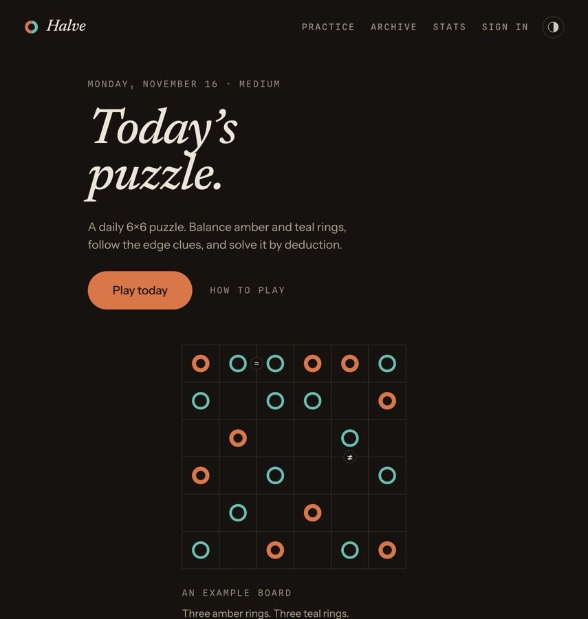

# Halve

[](https://github.com/bandicoutts/halve/actions/workflows/web.yml)
[](https://github.com/bandicoutts/halve/actions/workflows/web-e2e.yml)
[](https://github.com/bandicoutts/halve/actions/workflows/validator-parity.yml)

A premium daily 6×6 binary Latin-square puzzle. Two abstract symbols — **solid circle** and **ring** — fill a grid under three deduction-only rules: no three identical symbols in a row or column, each row and column is exactly balanced (half of each), and `=`/`≠` edge clues constrain adjacent pairs. Every puzzle has a unique solution reachable by logic alone, no guessing.

**Play it at [parity-web-rpwn.vercel.app](https://parity-web-rpwn.vercel.app).**



The interesting part is the engine: a generator, a human-style solver and a difficulty rater in `packages/engine`, pure TypeScript with no dependencies, shared by the web app and the Flutter app in `apps/mobile`.

## Architecture

| Layer | Technology |
|---|---|
| Web frontend | Next.js 16 + React 19 (server components) |
| Database / auth | Supabase (Postgres + Row-Level Security) |
| Hosting | Vercel |
| Puzzle engine | `packages/engine` — pure TypeScript, no deps |
| Design tokens | `packages/design` — single source of truth for colors, spacing, type |
| Mobile (planned) | Flutter (`apps/mobile`) |

The monorepo is managed with **pnpm workspaces**. The engine package is framework-agnostic and is vendored into the Supabase Edge Function for server-side puzzle generation.

See [`docs/ARCHITECTURE.md`](docs/ARCHITECTURE.md) for data model, request flows, and decision log.

## Getting started

### Prerequisites

- Node.js ≥ 20
- pnpm ≥ 10 (`npm install -g pnpm`)
- Flutter ≥ 3.x (mobile only)

### Web

```bash
# 1. Install dependencies
pnpm install

# 2. Add Supabase credentials (find in Supabase dashboard → Settings → API)
cp apps/web/.env.local.example apps/web/.env.local
# edit NEXT_PUBLIC_SUPABASE_URL and NEXT_PUBLIC_SUPABASE_ANON_KEY

# 3. Start the dev server
pnpm --filter @parity/web dev
# → http://localhost:3000
```

### Mobile (Flutter)

```bash
# From the repo root
pnpm mobile:run
# which runs: cd apps/mobile && flutter run --dart-define-from-file=env.json
```

`env.json` holds the Supabase URL and anon key for the mobile app. Copy the example file and fill in your credentials before the first run.

### Engine (pure TypeScript)

```bash
pnpm --filter @parity/engine test
pnpm --filter @parity/engine build
```

## Project structure

```
apps/
  web/          Next.js 16 frontend
  mobile/       Flutter app (iOS + Android)
packages/
  engine/       Puzzle generator, solver, validator (no deps, no DOM)
  design/       Design tokens — colors, spacing, type scale
supabase/
  migrations/   Postgres schema migrations
  functions/    Edge Functions (daily-puzzle generator cron target)
docs/
  ARCHITECTURE.md
  GAME-RULES.md
  DESIGN.md
  DECISIONS.md
  ROADMAP.md
scripts/        Seeder scripts and tooling
```
